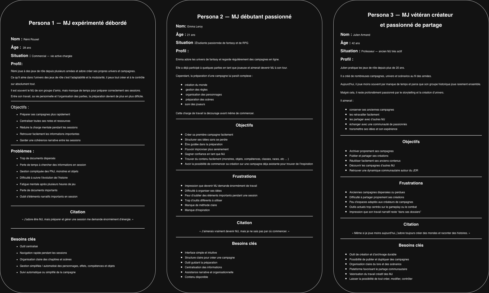

# Expression du besoin — Arcane Chronicles

**Projet** : Arcane Chronicles — application web de préparation et de pilotage de parties de Donjons & Dragons 5e
**Version** : 2.0 — 03/11/2026
**Auteur** : Lubin Chauvreau
**Cadre** : projet de formation Simplon — titre professionnel Concepteur Développeur d'Applications (CDA)
**Suite** : [`cahier-des-charges.md`](cahier-des-charges.md) (cahier des charges fonctionnel et technique)

---

## 1. La problématique

Dans un jeu de rôle sur table comme Donjons & Dragons, un **Maître du Jeu (MJ)** prépare une histoire (lieux, personnages, monstres, objets, quêtes) puis l'anime en direct devant 3 à 6 joueurs, autour d'une table, avec des dés physiques.

Aujourd'hui, ce travail repose sur des supports éparpillés : un document texte pour la narration, un tableur pour les monstres, des fiches papier pour les personnages, des images pour les cartes, et une feuille griffonnée pour suivre l'initiative et les points de vie pendant les combats. Cela pose trois problèmes concrets :

1. **Pendant la partie, le MJ cherche au lieu de jouer.** Il jongle entre ses documents pour retrouver la description d'une scène, les caractéristiques d'un garde ou l'objectif d'une quête. Le combat est le pire moment : il doit tenir à jour l'ordre de passage et les points de vie de chaque créature, tout en racontant.
2. **Les joueurs sont aveugles sur l'état du jeu.** Ils dépendent de la parole du MJ pour connaître leurs points de vie, leur inventaire ou l'avancement des quêtes, et ces informations se perdent d'une séance à l'autre.
3. **La préparation est lourde et rarement réutilisable.** Un MJ débutant n'ose pas se lancer face à la page blanche ; un MJ expérimenté refait sans cesse les mêmes PNJ et objets d'une campagne à l'autre.

## 2. Pour qui

| Utilisateur | Profil | Son problème principal |
|---|---|---|
| **Rémi** — MJ expérimenté débordé | Mène des campagnes longues, prépare tard le soir | Charge mentale en partie, perte de temps à chercher ses informations |
| **Emma** — MJ débutante | Découvre l'animation, manque de repères | Peur de la page blanche, peur d'oublier une règle ou un élément |
| **Julien** — MJ vétéran créateur | Écrit ses propres univers, aime partager | Ses créations ne se réutilisent ni ne se partagent facilement |
| **Le joueur** | Participe à la partie depuis la table, son téléphone en main | Ne voit pas l'état de son personnage ni de l'aventure |

Le MJ est l'utilisateur principal : c'est lui qui découvre l'outil, prépare la campagne et invite ses joueurs. Le joueur est un invité, qui doit pouvoir entrer dans la partie sans aucune friction (pas de compte, pas d'installation).

## 3. Pourquoi les outils existants ne suffisent pas

Deux familles d'outils existent, et aucune ne couvre le moment clé, la partie autour de la table :

- les **tables de jeu virtuelles** sont pensées pour le jeu à distance et la résolution tactique (grille, pions, calcul automatique des jets) : lourdes à préparer, elles déplacent la partie sur l'écran ;
- les **outils de rédaction et de worldbuilding** sont riches pour écrire un univers, mais absents pendant la partie : ils n'ont ni temps réel, ni suivi du combat, ni vue joueur.

## 4. La réponse apportée par l'application

Arcane Chronicles fait le lien entre la préparation et la partie, avec une règle simple : **l'application est la mémoire et le tableau de bord du MJ, pas un moteur de règles.** Les joueurs lancent leurs vrais dés, le MJ arbitre, l'application enregistre et diffuse.

- **Préparer une fois, jouer sans chercher** : la campagne est structurée (campagne → chapitres → scènes) et chaque scène regroupe sa narration, ses personnages, ses quêtes, ses coffres, énigmes et pièges.
- **Piloter la partie depuis un seul écran** : le MJ a toute la scène sous les yeux, gère le combat (initiative, ordre de tour, points de vie) et décide de ce qu'il révèle aux joueurs.
- **Mettre les joueurs dans la boucle** : chaque joueur suit son personnage, son inventaire et ses quêtes sur son téléphone, mis à jour en temps réel.
- **Ne jamais repartir de zéro** : un catalogue de campagnes et de contenus prêts à l'emploi, une bibliothèque personnelle d'objets, de capacités et d'effets, et une partie qui reprend exactement là où elle s'était arrêtée.

## 5. Objectifs et indicateurs de réussite

| # | Objectif | Indicateur |
|---|---|---|
| O1 | Un MJ prépare une campagne jouable rapidement | Un MJ débutant prépare une campagne jouable en moins de 45 min |
| O2 | Le MJ anime toute sa partie depuis l'application | Une partie de 2 h se joue sans ouvrir d'autre outil que l'application et les dés |
| O3 | Les joueurs utilisent l'interface mobile | ≥ 60 % des joueurs ouvrent leur fiche pendant la partie |
| O4 | L'état du jeu est fiable et partagé | Une modification du MJ apparaît chez les joueurs en moins de 500 ms ; aucune donnée secrète du MJ n'atteint un joueur |
| O5 | La campagne se joue dans la durée | Une partie interrompue reprend avec tout son état (PV, morts, objectifs, stocks, coffres) |
