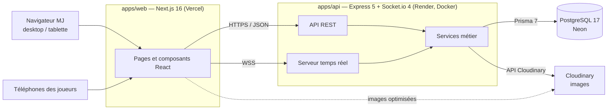
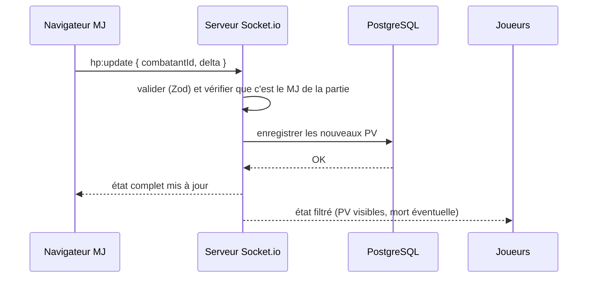

# Architecture — Arcane Chronicles

**Mise à jour** : 03/11/2026
**Documents liés** : [cahier des charges technique](../01-contexte/cahier-des-charges.md#2-cahier-des-charges-technique), [modèles de données](mcd/), [sécurité](../04-securite/securite.md), [déploiement](../06-deploiement/deploiement.md)

> Les versions et la justification de chaque technologie sont dans le cahier des charges (§2.3 à §2.11). Ce document décrit comment les morceaux s'assemblent. Les noms de dossiers, de routes et d'événements sont ceux **prévus** ; ils seront ajustés pendant le développement.

---

## 1. Vue d'ensemble



- **Frontend** : affiche l'interface. Il ne contient aucune règle métier ni aucun secret.
- **Backend** : seul point d'entrée vers la base. Il porte les règles métier, les droits et l'état des parties en cours (serveur d'autorité).
- **Base** : source de vérité. L'état de jeu est enregistré sur les éléments de la campagne (PV, morts, objectifs, stocks, coffres).

---

## 2. Monorepo

```
arcane-chronicles/
├── package.json              # workspaces npm, scripts communs
├── docker-compose.yml        # postgres en local, images web + api de production
├── .devcontainer/            # environnement de développement commun (Dev Container)
├── apps/
│   ├── web/                  # Next.js
│   │   ├── Dockerfile
│   │   └── src/
│   │       ├── app/          # routes (App Router)
│   │       ├── assets/       # polices, police d'icônes, images, vidéos
│   │       ├── components/   # composants repris de la page « composants » de Figma
│   │       ├── lib/          # client API (apiFetch), client Socket.io, polices
│   │       └── styles/       # design system : variables, mixins, classes globales
│   └── api/                  # Express + Socket.io
│       ├── Dockerfile
│       ├── prisma/           # schema.prisma, migrations, seeds (référence D&D et démo)
│       ├── prisma.config.ts
│       └── src/
│           ├── index.ts      # point d'entrée (serveur HTTP + Socket.io)
│           ├── config.ts     # application Express, routeur /api
│           ├── routers/      # un routeur par ressource REST
│           ├── controllers/  # actions par ressource (logique métier, réponse HTTP)
│           ├── models/       # accès aux données avec Prisma
│           ├── database/     # client Prisma
│           ├── sockets/      # serveur temps réel, handlers par domaine
│           ├── services/     # auth, sécurité, validation, règles de jeu partagées
│           ├── middlewares/  # gestion des erreurs
│           └── lib/          # journalisation (pino)
├── packages/
│   └── shared/               # schémas Zod, types d'événements, constantes de règles
└── docs/                     # documentation CDA
    └── preuves/              # captures, logs, exports, rapports
```

Le dossier `packages/shared` est importé par les deux applications : un schéma Zod écrit une fois sert à valider le formulaire côté front et la requête côté back.

---

## 3. Backend en couches

```
Requête HTTP
  → helmet, cors, rate-limit, cookie-parser     (sécurité générale)
  → authentification (JWT du cookie)            (qui es-tu ?)
  → validation Zod                              (la requête est-elle bien formée ?)
  → contrôle des droits                         (as-tu le droit ?)
  → controller → model → Prisma                 (traitement)
  → réponse JSON, ou erreur centralisée
```

### Organisation des fichiers (`apps/api/src/`)

| Fichier ou dossier | Rôle |
|---|---|
| `index.ts` | Point d'entrée : crée le serveur HTTP, y greffe Socket.io, lance l'écoute |
| `config.ts` | Configuration de l'application Express : middlewares (helmet, cors, JSON, cookies, logs), routeur monté sur `/api`, gestion des erreurs |
| `routers/router.ts` | Routeur principal : assemble les routeurs de chaque ressource (`router.use('/campaigns', …)`) |
| `routers/<ressource>/router.ts` | Associe les URL et méthodes d'une ressource à ses actions, déclare les middlewares (authentification, validation, droits) |
| `controllers/<ressource>Actions.ts` | Actions d'une ressource (`browse`, `read`, `add`, `edit`, `destroy`) : logique métier, appel du modèle, code HTTP et réponse |
| `models/<ressource>Model.ts` | Accès aux données d'une ressource avec Prisma (méthodes statiques `getAll`, `getById`, `create`, `update`, `delete`) |
| `database/db.ts` | Client Prisma unique, connecté par l'adaptateur PostgreSQL |
| `sockets/index.ts` | Serveur temps réel (Socket.io) ; les événements sont rangés par domaine dans `sockets/handlers/` |
| `services/` | Outils transverses : authentification, sécurité, validation, et règles de jeu partagées entre les routes et les sockets |
| `middlewares/errorHandler.ts` | Transforme une erreur en réponse propre et la journalise ; ne divulgue jamais le détail au client |
| `lib/logger.ts` | Journalisation (pino) |

| Couche | Responsabilité | Ne fait pas |
|---|---|---|
| Router | Associe une URL et une méthode à une action, déclare les middlewares | Aucune logique |
| Controller | Lit les paramètres validés, applique les règles métier, appelle le modèle, renvoie le code HTTP | Pas de requête Prisma directe |
| Model | Requêtes Prisma d'une ressource (sélection, relations à inclure, pagination) | Ne connaît ni Express ni Socket.io |
| Middleware d'erreur | Transforme une erreur en réponse propre (400, 401, 403, 404, 422, 500) et la journalise avec pino | Ne divulgue pas la pile d'erreur au client |

Toutes les routes sont préfixées par `/api` (ex. `GET /api/health`). Les règles de jeu utilisées à la fois par une route REST et par un événement temps réel (par exemple « modifier les PV ») sont des fonctions de `services/` indépendantes d'Express et de Socket.io : elles sont appelées par l'action **et** par le handler, et se testent sans serveur.

Socket.io ne passe pas par une route Express : il se greffe sur le même serveur HTTP (port 4000) et écoute sur son propre chemin (`/socket.io`). Les routes REST servent à préparer la campagne, les sockets à jouer la partie.

---

## 4. Temps réel

### 4.1 Rooms

| Room | Membres | Reçoit |
|---|---|---|
| `game:<id>:gm` | Le MJ de la partie | Tout l'état, y compris les secrets |
| `game:<id>:players` | Les joueurs de la partie | Uniquement ce qui a été révélé, filtré côté serveur |

### 4.2 Déroulé d'une action du MJ



### 4.3 Événements prévus

| Événement | Émis par | Effet |
|---|---|---|
| `game:join` | Joueur | Entrée dans la partie avec un pseudo, remise du jeton de reconnexion |
| `game:assign-hero` | MJ | Attribution d'un héros prétiré à un joueur |
| `scene:change` | MJ | Changement de scène active |
| `element:reveal` | MJ | Révélation d'un PNJ, coffre, énigme, piège ou objet |
| `hp:update` | MJ | Ajout ou retrait de PV (mort à 0) |
| `combat:start` / `combat:end` | MJ | Début et fin de combat |
| `combat:initiative` | MJ | Saisie de l'initiative d'un combattant |
| `turn:next` | MJ | Passage au combattant vivant suivant |
| `objective:validate` | MJ | Validation d'un objectif de quête |
| `inventory:update` | MJ | Butin, commerce, récompenses |
| `item:use` | Joueur | Utilisation d'un consommable |
| `game:state` | Serveur | Envoi de l'état (complet au MJ, filtré aux joueurs) |

À la reconnexion, le client reçoit un `game:state` relu depuis la base : il n'y a pas d'état gardé seulement en mémoire.

---

## 5. Frontend

| Zone | Pages prévues | Rendu |
|---|---|---|
| Publique | Accueil, catalogue, détail d'une campagne publique, connexion, inscription | Rendu serveur (affichage rapide, indexable) |
| MJ | Tableau de bord, édition de campagne / chapitre / scène, personnages, bibliothèque, lobby, partie | Rendu client après authentification |
| Joueur | Entrée par code, fiche (profil, inventaire, compétences, quêtes, carte), combat | Rendu client, mobile 350–375 px |

- Styles en `.module.scss`, variables de couleur de la [charte](maquettes/brand.md), variables, mixins et classes globales du [design system](design-system.md).
- Polices et police d'icônes chargées depuis `apps/web/src/assets/fonts`.
- Glisser-déposer du lobby avec `@dnd-kit/core`.

### Appels à l'API

Tous les appels REST passent par `apiFetch` (`apps/web/src/lib/api.ts`) : une méthode par verbe HTTP, qui préfixe `/api`, envoie les cookies (authentification) et convertit la réponse.

```ts
const { data } = await apiFetch.get<{ data: Campaign[] }>('/campaigns');
await apiFetch.post('/campaigns', form);
await apiFetch.put(`/campaigns/${id}`, form);
await apiFetch.patch(`/objectives/${id}`, { isCompleted: true });
await apiFetch.delete(`/campaigns/${id}`);
```

| Corps passé | Envoi |
|---|---|
| Objet ou tableau | JSON (`Content-Type: application/json`) |
| Objet contenant un fichier (`{ ...form, image: file }`) | `multipart/form-data` automatiquement : texte et nombres en champs, fichiers en pièces jointes, objets imbriqués en JSON |
| `FormData` ou fichier seul | tel quel |
| Aucun (`get`, `delete`) | ni corps ni `Content-Type` |

| Réponse | Résultat |
|---|---|
| 2xx en JSON | l'objet renvoyé, typé avec `apiFetch.get<Type>(...)` |
| 204 (sans contenu) | `null` |
| 4xx ou 5xx | une `ApiError` avec `status` et `data` (la réponse de l'API), par exemple la liste `errors: [{ field, message }]` d'une validation refusée (422), à afficher sous les champs du formulaire |

Le dernier argument (`options`) accepte les options de `fetch` : en-têtes supplémentaires, `signal` pour annuler une requête, options de cache de Next.js. Le temps réel passe par le client Socket.io (`apps/web/src/lib/socket.ts`), sur la même adresse sans préfixe `/api`.

---

## 6. Données

Le modèle (38 tables, 14 énumérations) est décrit dans [`mcd/`](mcd/) : MCD, MLD et MPD global et par fonctionnalité, et le code source `05-database-model-v2.dbml`. Il est traduit en `schema.prisma` ; les contraintes que Prisma n'exprime pas (CHECK, index unique partiel) sont ajoutées dans les migrations SQL.

Les migrations sont dans `apps/api/prisma/migrations/`. La première, `20261105000000_init`, crée les 14 énumérations et les 38 tables (générée par `prisma migrate diff` depuis le schéma), puis ajoute à la main :

| Contrainte | Table | Règle |
|---|---|---|
| `quests_main_has_no_chapter_check` | `quests` | CHECK : une quête `MAIN` n'a pas de chapitre, une quête `SIDE` en a un (RG7) |
| `quests_one_main_per_campaign_key` | `quests` | index unique partiel : une seule quête `MAIN` par campagne |
| `objectives_at_most_one_target_check` | `objectives` | CHECK : au plus une cible par objectif |
| `combatants_exactly_one_source_check` | `combatants` | CHECK : un combattant est soit une fiche unique (`character_id`), soit une créature posée (`scene_creature_id`), jamais les deux ni aucun |

Prisma ignore ces contraintes lorsqu'il compare le schéma à la base : une nouvelle migration (`npm run prisma:migrate -- --name ...`) ne cherche pas à les supprimer. Toute modification ultérieure du modèle passe par une nouvelle migration, appliquée en production au démarrage de l'API (`prisma migrate deploy`).
