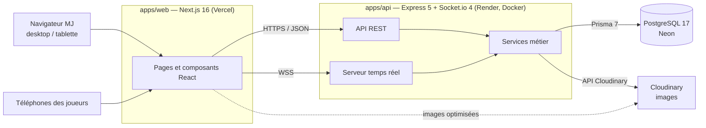
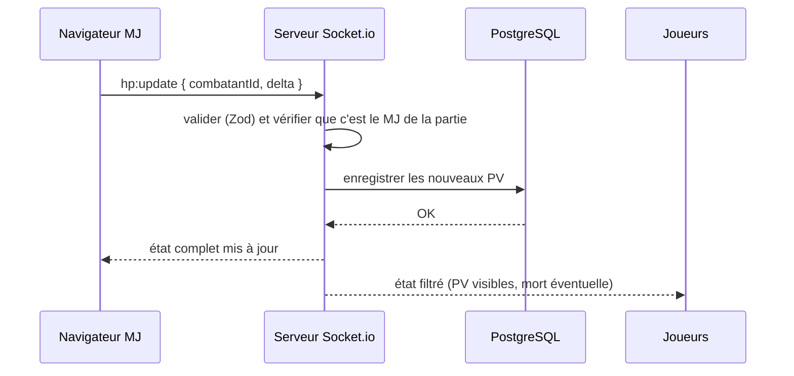

# Architecture — Arcane Chronicles

**Mise à jour** : 03/11/2026
**Documents liés** : [cahier des charges technique](../01-contexte/cahier-des-charges.md#2-cahier-des-charges-technique), [modèles de données](mcd/), [sécurité](../04-securite/securite.md), [déploiement](../06-deploiement/deploiement.md)

> Les versions et la justification de chaque technologie sont dans le cahier des charges (§2.3 à §2.11). Ce document décrit comment les morceaux s'assemblent. Les noms de dossiers, de routes et d'événements sont ceux **prévus** ; ils seront ajustés pendant le développement.

---

## 1. Vue d'ensemble



- **Frontend** : affiche l'interface. Il ne contient aucune règle métier ni aucun secret.
- **Backend** : seul point d'entrée vers la base. Il porte les règles métier, les droits et l'état des parties en cours (serveur d'autorité).
- **Base** : source de vérité. L'état de jeu est enregistré sur les éléments de la campagne (PV, morts, objectifs, stocks, coffres).

---

## 2. Monorepo

```
arcane-chronicles/
├── package.json              # workspaces npm, scripts communs
├── docker-compose.yml        # postgres en local, images web + api de production
├── .devcontainer/            # environnement de développement commun (Dev Container)
├── apps/
│   ├── web/                  # Next.js
│   │   ├── Dockerfile
│   │   ├── public/           # fichiers servis tels quels (vidéo de fond complète et recadrée en portrait, son image fixe, illustrations de la campagne de démo)
│   │   └── src/
│   │       ├── app/          # routes (App Router)
│   │       ├── assets/       # polices, police d'icônes, images, vidéos
│   │       ├── components/   # composants repris de la page « composants » de Figma (lib/ : composants génériques ; campaign/ : cartes et progression des campagnes)
│   │       ├── hooks/        # logique réutilisable (useAuth : connexion, inscription, déconnexion, erreurs de formulaire ; useDisclosure : ouverture d'une bulle ; useSearchBar : ouverture de la barre de recherche repliée ; useFitLines : nombre de lignes qui tiennent dans un bloc)
│   │       ├── lib/          # client API (apiFetch, serverGet), session (auth), campagnes, formats (dates, quantités), paramètres d'adresse (buildUrl), recherche (matchesSearch), client Socket.io, polices, règles du mot de passe, classe de page
│   │       └── styles/       # design system : variables, mixins, animations, classes globales
│   └── api/                  # Express + Socket.io
│       ├── Dockerfile
│       ├── prisma/           # schema.prisma, migrations, seeds (référence D&D et démo)
│       ├── prisma.config.ts
│       └── src/
│           ├── index.ts      # point d'entrée (serveur HTTP + Socket.io)
│           ├── config.ts     # application Express, routeur /api
│           ├── routers/      # un routeur par ressource REST
│           ├── controllers/  # actions par ressource (logique métier, réponse HTTP)
│           ├── models/       # accès aux données avec Prisma
│           ├── database/     # client Prisma
│           ├── sockets/      # serveur temps réel, handlers par domaine
│           ├── services/     # auth, sécurité, validation, règles de jeu partagées
│           ├── middlewares/  # rangés par rôle : errors/, limiters/, validation/
│           └── lib/          # journalisation (pino)
├── packages/
│   └── shared/               # schémas Zod, types d'événements, constantes de règles
└── docs/                     # documentation CDA
    └── preuves/              # captures, logs, exports, rapports
```

Le dossier `packages/shared` est importé par les deux applications : un schéma Zod écrit une fois sert à valider le formulaire côté front et la requête côté back.

---

## 3. Backend en couches

```
Requête HTTP
  → helmet, cors, rate-limit, cookie-parser     (sécurité générale)
  → authentification (JWT du cookie)            (qui es-tu ?)
  → validation Zod                              (la requête est-elle bien formée ?)
  → contrôle des droits                         (as-tu le droit ?)
  → controller → model → Prisma                 (traitement)
  → réponse JSON, ou erreur centralisée
```

### Organisation des fichiers (`apps/api/src/`)

| Fichier ou dossier | Rôle |
|---|---|
| `index.ts` | Point d'entrée : crée le serveur HTTP, y greffe Socket.io, lance l'écoute |
| `config.ts` | Configuration de l'application Express : middlewares (helmet, cors, JSON, cookies, logs), routeur monté sur `/api`, gestion des erreurs |
| `routers/router.ts` | Routeur principal : assemble les routeurs de chaque ressource (`router.use('/campaigns', …)`) |
| `routers/<ressource>/router.ts` | Associe les URL et méthodes d'une ressource à ses actions, déclare les middlewares (authentification, validation, droits) |
| `controllers/<ressource>Actions.ts` | Actions d'une ressource (`browse`, `read`, `add`, `edit`, `destroy`) : logique métier, appel du modèle, code HTTP et réponse |
| `models/<ressource>Model.ts` | Accès aux données d'une ressource avec Prisma (méthodes statiques `getAll`, `getById`, `create`, `update`, `delete`) |
| `database/db.ts` | Client Prisma unique, connecté par l'adaptateur PostgreSQL |
| `sockets/index.ts` | Serveur temps réel (Socket.io) ; les événements sont rangés par domaine dans `sockets/handlers/` |
| `services/` | Outils transverses : authentification, sécurité, validation, et règles de jeu partagées entre les routes et les sockets |
| `middlewares/errors/errorHandler.ts` | Transforme une erreur en réponse propre et la journalise ; ne divulgue jamais le détail au client |
| `middlewares/validation/validate.ts` | Valide le corps d'une requête avec un schéma Zod de `packages/shared` ; renvoie 422 avec `errors: [{ field, message }]` |
| `middlewares/errors/notFound.ts` | Répond 404 en JSON pour toute route inconnue (monté après le routeur `/api`, avant le middleware d'erreur) |
| `middlewares/limiters/rateLimiter.ts` | Fabrique les limiteurs (express-rate-limit) : réponse 429 avec `message` et `retryAfter` (secondes restantes) |
| `middlewares/limiters/loginLimiter.ts` | Limite les tentatives de connexion échouées : 5 par adresse IP sur 15 minutes |
| `middlewares/limiters/registerLimiter.ts` | Limite les tentatives d'inscription, réussies ou non : 10 par adresse IP sur une heure (risque R11) |
| `types/` | Types TypeScript partagés entre plusieurs couches (`AuthPayload`), et extension du type `Request` d'Express (`req.auth`) |
| `lib/logger.ts` | Journalisation (pino) |

| Couche | Responsabilité | Ne fait pas |
|---|---|---|
| Router | Associe une URL et une méthode à une action, déclare les middlewares | Aucune logique |
| Controller | Lit les paramètres validés, applique les règles métier, appelle le modèle, renvoie le code HTTP | Pas de requête Prisma directe |
| Model | Requêtes Prisma d'une ressource (sélection, relations à inclure, pagination) | Ne connaît ni Express ni Socket.io |
| Middleware d'erreur | Transforme une erreur en réponse propre (400, 401, 403, 404, 422, 500) et la journalise avec pino | Ne divulgue pas la pile d'erreur au client |

Toutes les routes sont préfixées par `/api` (ex. `GET /api/health`).

Toutes les erreurs ont la même forme : `{ message }`, en anglais (ex. `{ "message": "Route not found" }`), et `{ errors: [{ field, message }] }` pour une validation refusée. Le middleware d'erreur renvoie le code de l'erreur quand il s'agit d'une erreur du client (400 à 499, par exemple un JSON mal formé) et 500 sinon, sans jamais renvoyer le détail d'une erreur serveur.

Routes d'authentification (`routers/auth/`, actions dans `controllers/authActions.ts`) :

| Route | Middlewares | Réponse |
|---|---|---|
| `POST /api/auth/login` | `loginLimiter`, `validate(loginSchema)` | 200 avec l'utilisateur (`id`, `displayName`, `email`, `avatarUrl`) et le cookie de session ; le jeton du cookie ne contient que l'identité (`id`, `displayName`, `email`), pas l'avatar, qui peut changer pendant la durée de vie du jeton ; 401 si l'e-mail ou le mot de passe est faux ; 422 si le corps est invalide ; 429 après trop d'échecs, avec `retryAfter` (secondes restantes) |
| `POST /api/auth/logout` | aucun | 200 et suppression du cookie, même si la session a déjà expiré |
| `POST /api/auth/register` | `registerLimiter`, `validate(registerSchema)` | 201 avec l'utilisateur et le cookie de session ; 409 si l'e-mail a déjà un compte ; 422 si le corps est invalide ; 429 après trop d'inscriptions |
| `GET /api/auth/me` | `checkCookie` | 200 avec l'utilisateur lu en base ; 401 sans session valide. Permet au front de savoir qui est connecté au chargement d'une page |

Routes des campagnes (`routers/campaigns/`, actions dans `controllers/campaignActions.ts`) :

| Route | Middlewares | Réponse |
|---|---|---|
| `GET /api/campaigns` ou `?scope=public` | `optionalAuth`, `validate(campaignListQuerySchema, 'query')` | 200 avec le catalogue : les campagnes publiques (versions publiées, RG20), avec le nom de leur MJ |
| `GET /api/campaigns?scope=mine` | idem | 200 avec les campagnes d'origine du MJ connecté (`CampaignSummary` : statut, progression, chapitre en cours et sa progression (objectifs de la quête principale rattachés au chapitre), compteurs, dernière session, publication ; calcul dans `services/campaigns/campaignSummary.ts`) ; 401 sans session valide. L'identité du MJ vient toujours du cookie, jamais de l'URL |
| `GET /api/campaigns?scope=…` (autre valeur) | idem | 422 `{ errors: [{ field: "scope", message }] }` |
| `GET /api/campaigns/:id` | `checkCookie`, `validate(campaignIdParamsSchema, 'params')` | 200 avec la campagne d'origine du MJ connecté (`CampaignDetail` : `id`, `title`, `imageUrl`) ; 404 si elle n'existe pas ou appartient à un autre MJ (on ne révèle pas son existence) ; 401 sans session valide ; 422 si l'identifiant n'est pas un UUID |

`optionalAuth` lit la session si elle existe et l'ignore si le cookie est absent, invalide ou expiré : le catalogue reste accessible à un visiteur qui a gardé un ancien cookie. Si le secret JWT manque dans la configuration, il renvoie une erreur 500 au lieu de traiter le MJ comme un visiteur. `validate(schema, source)` valide le corps (`body`, par défaut), les paramètres d'URL (`query`) ou les segments de la route (`params`), et remplace la donnée par la valeur validée (valeurs par défaut comprises). Une route n'a qu'un `validate` par source : pour ajouter des filtres, on étend le schéma existant (`z.object({ ...campaignListQuerySchema.shape, … })`) plutôt que d'enchaîner deux `validate`, car le second supprimerait les clés inconnues du premier.

Les règles de jeu utilisées à la fois par une route REST et par un événement temps réel (par exemple « modifier les PV ») sont des fonctions de `services/` indépendantes d'Express et de Socket.io : elles sont appelées par l'action **et** par le handler, et se testent sans serveur.

Socket.io ne passe pas par une route Express : il se greffe sur le même serveur HTTP (port 4000) et écoute sur son propre chemin (`/socket.io`). Les routes REST servent à préparer la campagne, les sockets à jouer la partie.

---

## 4. Temps réel

### 4.1 Rooms

| Room | Membres | Reçoit |
|---|---|---|
| `game:<id>:gm` | Le MJ de la partie | Tout l'état, y compris les secrets |
| `game:<id>:players` | Les joueurs de la partie | Uniquement ce qui a été révélé, filtré côté serveur |

### 4.2 Déroulé d'une action du MJ



### 4.3 Événements prévus

| Événement | Émis par | Effet |
|---|---|---|
| `game:join` | Joueur | Entrée dans la partie avec un pseudo, remise du jeton de reconnexion |
| `game:assign-hero` | MJ | Attribution d'un héros prétiré à un joueur |
| `scene:change` | MJ | Changement de scène active |
| `element:reveal` | MJ | Révélation d'un PNJ, coffre, énigme, piège ou objet |
| `hp:update` | MJ | Ajout ou retrait de PV (mort à 0) |
| `combat:start` / `combat:end` | MJ | Début et fin de combat |
| `combat:initiative` | MJ | Saisie de l'initiative d'un combattant |
| `turn:next` | MJ | Passage au combattant vivant suivant |
| `objective:validate` | MJ | Validation d'un objectif de quête |
| `inventory:update` | MJ | Butin, commerce, récompenses |
| `item:use` | Joueur | Utilisation d'un consommable |
| `game:state` | Serveur | Envoi de l'état (complet au MJ, filtré aux joueurs) |

À la reconnexion, le client reçoit un `game:state` relu depuis la base : il n'y a pas d'état gardé seulement en mémoire.

---

## 5. Frontend

| Zone | Pages prévues | Rendu |
|---|---|---|
| Publique | Accueil, catalogue, détail d'une campagne publique, connexion, inscription | Rendu serveur (affichage rapide, indexable) |
| MJ | Tableau de bord, édition de campagne / chapitre / scène, personnages, bibliothèque, lobby, partie | Rendu client après authentification |
| Joueur | Entrée par code, fiche (profil, inventaire, compétences, quêtes, carte), combat | Rendu client, mobile 350–375 px |

- Styles en `.module.scss`, variables de couleur de la [charte](maquettes/brand.md), variables, mixins et classes globales du [design system](design-system.md).
- Polices et police d'icônes chargées depuis `apps/web/src/assets/fonts`.
- Glisser-déposer du lobby avec `@dnd-kit/core`.

### Appels à l'API

Tous les appels REST passent par `apiFetch` (`apps/web/src/lib/api.ts`) : une méthode par verbe HTTP, qui préfixe `/api`, envoie les cookies (authentification) et convertit la réponse.

```ts
const { data } = await apiFetch.get<{ data: Campaign[] }>('/campaigns');
await apiFetch.post('/campaigns', form);
await apiFetch.put(`/campaigns/${id}`, form);
await apiFetch.patch(`/objectives/${id}`, { isCompleted: true });
await apiFetch.delete(`/campaigns/${id}`);
```

| Corps passé | Envoi |
|---|---|
| Objet ou tableau | JSON (`Content-Type: application/json`) |
| Objet contenant un fichier (`{ ...form, image: file }`) | `multipart/form-data` automatiquement : texte et nombres en champs, fichiers en pièces jointes, objets imbriqués en JSON |
| `FormData` ou fichier seul | tel quel |
| Aucun (`get`, `delete`) | ni corps ni `Content-Type` |

| Réponse | Résultat |
|---|---|
| 2xx en JSON | l'objet renvoyé, typé avec `apiFetch.get<Type>(...)` |
| 204 (sans contenu) | `null` |
| 4xx ou 5xx | une `ApiError` avec `status` et `data` (la réponse de l'API), par exemple la liste `errors: [{ field, message }]` d'une validation refusée (422), à afficher sous les champs du formulaire |

Le dernier argument (`options`) accepte les options de `fetch` : en-têtes supplémentaires, `signal` pour annuler une requête, options de cache de Next.js.

Dans un composant serveur (page, layout), le navigateur n'est pas là pour joindre le cookie de session : les lectures passent par `serverGet` (`apps/web/src/lib/serverApi.ts`), qui lit le cookie `token` de la requête avec `cookies()` de Next, le transmet à l'API et désactive le cache (`no-store`). Ce fichier est séparé de `api.ts`, car `cookies()` n'existe que côté serveur et `api.ts` est aussi importé par des composants client (`useAuth`). Les fonctions de chaque ressource s'appuient dessus : `getSession` (`lib/auth.ts`), `getMyCampaigns` et `getCampaign` (`lib/campaigns.ts`, qui renvoie `null` sur un 404 ou un 422 pour que la page affiche `notFound()`).

Le temps réel passe par le client Socket.io (`apps/web/src/lib/socket.ts`), sur la même adresse sans préfixe `/api`.

### Espace MJ : layout et sidebar

Les pages du MJ (`app/(gm)/`) partagent un layout, `app/(gm)/layout.tsx`, qui affiche la sidebar à gauche et la page à droite.

| Élément | Rendu | Rôle |
|---|---|---|
| `(gm)/layout.tsx` | serveur | Récupère le MJ (`getCurrentUser`) et ses campagnes (`getMyCampaigns`), puis les passe à la sidebar. Sans session valide, il n'affiche pas de sidebar et ne demande pas les campagnes : c'est la page qui redirige vers la connexion. |
| `SidebarShell` | client | La coque (`<aside id="gm-sidebar">`) : elle lit l'état ouvert ou fermé dans `ArcaneContext` et anime l'ouverture. |
| `Sidebar` et ses blocs | serveur | Le contenu, passé à la coque en `children` : profil, « Reprendre », « Mon atelier ». |

Un layout ne peut pas passer de props à sa page : la page des campagnes appelle donc elle aussi `getMyCampaigns`. Les deux appels ne coûtent qu'une requête à l'API, car `getMyCampaigns` et `getSession` sont enveloppées dans `cache` de React, qui garde le résultat pendant le rendu d'une même requête.

Seule la coque est un composant client : elle a besoin du contexte et d'un état. Le contenu reste rendu côté serveur, sans JavaScript envoyé au navigateur pour l'afficher. Un composant client peut afficher des composants serveur reçus en `children` ; s'il les importait lui-même, ils deviendraient des composants client.

**État ouvert ou fermé** : `isSidebarOpen` et `toggleSidebar` dans `ArcaneContext`, que le bouton du `Header` utilise (affiché seulement dans l'espace MJ, avec `aria-expanded` et `aria-controls="gm-sidebar"`). L'état est gardé dans un cookie `sidebar` (`open` ou `closed`, un an, `SameSite=Lax`, fonctions dans `lib/sidebar.ts`), que le layout racine lit avec `cookies()` pour initialiser le contexte. Le serveur rend donc directement la sidebar dans le bon état. Avec le `localStorage`, que seul le navigateur peut lire, la page s'afficherait d'abord ouverte, puis se refermerait au chargement du JavaScript.

**Mise à jour des données** : la sidebar est rendue côté serveur, elle ne se met pas à jour seule. Quand les futurs formulaires modifieront une campagne (titre, statut, image), il faudra demander à Next de refaire le rendu serveur : `router.refresh()` côté client, ou `revalidatePath()` dans une action serveur. La page n'est pas rechargée : seules les données changent, et l'état des composants client (sidebar ouverte, recherche en cours) est gardé.

**Hauteur du header** : le `Header` publie sa hauteur dans la variable CSS `--header-height` (sur `<html>`, mise à jour par un `ResizeObserver`). La sidebar et le `PageHeader` collant s'en servent pour se placer juste en dessous.

---

## 6. Données

Le modèle (38 tables, 14 énumérations) est décrit dans [`mcd/`](mcd/) : MCD, MLD et MPD global et par fonctionnalité, et le code source `05-database-model-v2.dbml`. Il est traduit en `schema.prisma` ; les contraintes que Prisma n'exprime pas (CHECK, index unique partiel) sont ajoutées dans les migrations SQL.

Les migrations sont dans `apps/api/prisma/migrations/`. La première, `20261105000000_init`, crée les 14 énumérations et les 38 tables (générée par `prisma migrate diff` depuis le schéma), puis ajoute à la main :

| Contrainte | Table | Règle |
|---|---|---|
| `quests_main_has_no_chapter_check` | `quests` | CHECK : une quête `MAIN` n'a pas de chapitre, une quête `SIDE` en a un (RG7) |
| `quests_one_main_per_campaign_key` | `quests` | index unique partiel : une seule quête `MAIN` par campagne |
| `objectives_at_most_one_target_check` | `objectives` | CHECK : au plus une cible par objectif |
| `combatants_exactly_one_source_check` | `combatants` | CHECK : un combattant est soit une fiche unique (`character_id`), soit une créature posée (`scene_creature_id`), jamais les deux ni aucun |

La deuxième, `20261123000000_campaign_publication` (RG20, versions publiques des campagnes), ajoute à `campaigns` les colonnes `published_from_id` (version publique → campagne d'origine, unique, `ON DELETE RESTRICT`) et `published_at`. Elle repasse en privées les campagnes publiques qui ne sont pas des versions publiées (la campagne de démonstration), puis ajoute à la main :

| Contrainte | Table | Règle |
|---|---|---|
| `campaigns_only_published_version_is_public_check` | `campaigns` | CHECK : seule une version publique (`published_from_id` renseigné) peut avoir `is_public` à vrai ; une campagne d'origine n'est jamais publique (RG20) |

La troisième, `20261124000000_campaign_description_required`, rend la description d'une campagne obligatoire (`description` en `NOT NULL`) : chaque carte du tableau de bord l'affiche.

La quatrième, `20261125000000_user_avatar`, ajoute à `users` la colonne facultative `avatar_url` (URL de l'image d'avatar). Sans avatar, l'interface affiche l'initiale du nom. L'envoi de l'image fait l'objet du ticket KAN-537.

Prisma ignore ces contraintes lorsqu'il compare le schéma à la base : une nouvelle migration (`npm run prisma:migrate -- --name ...`) ne cherche pas à les supprimer. Toute modification ultérieure du modèle passe par une nouvelle migration, appliquée en production au démarrage de l'API (`prisma migrate deploy`).

### Seeds

Deux seeds remplissent la base :

- `npm run seed` (`prisma/seed.ts`, données dans `prisma/seeds/reference.ts`) : les données de référence D&D (races, classes, historiques, compétences, capacités, effets et objets officiels) ;
- `npm run seed:demo` (`prisma/seed-demo.ts`) : le compte MJ de démonstration et trois campagnes (« L’archipel du néant » en cours, « La malédiction de Brumecombe » terminée, « Les forges de Khaz Dumar » pas commencée), pour montrer chaque état du tableau de bord. Il efface d'abord les données du MJ de démonstration, il peut donc être relancé sans créer de doublons.

Chaque campagne de démonstration est décrite comme un simple objet (`prisma/seeds/campaigns/*.ts`) : personnages, chapitres, scènes, quêtes, liés entre eux par leur nom. Le constructeur `prisma/seeds/builder.ts` insère ces objets dans le bon ordre, retrouve les identifiants générés par la base et déduit les données qui en découlent (capacités héritées de la race et de la classe, objectifs cochés et scènes jouées dans un chapitre terminé, créatures numérotées).

> **Choix proposé par l'IA.** Ce constructeur a été proposé et écrit avec l'assistant IA (Claude) pour simplifier l'insertion des données de démonstration : le modèle compte 38 tables très liées entre elles, et écrire chaque insertion à la main pour trois campagnes complètes aurait demandé des milliers de lignes et de nombreux identifiants à reporter. Il ne sert qu'au seed de démonstration ; le code de l'application n'en dépend pas.
